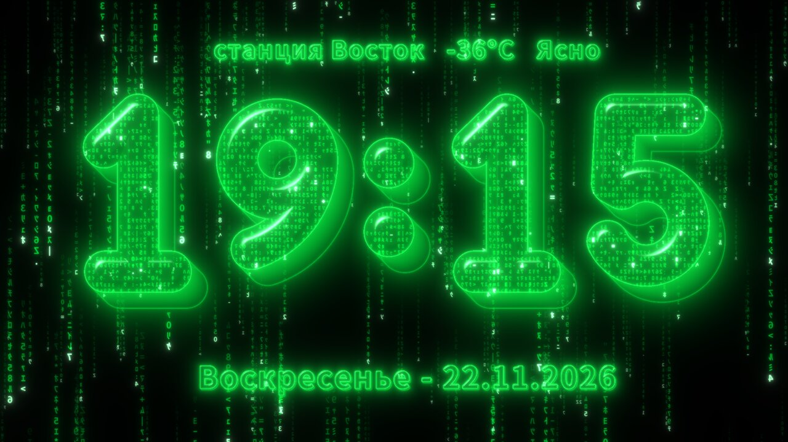

# MatrixClock

[Русский](README.md) · **English**

A Matrix-style 3D clock screensaver and session locker for Linux — for the X11 desktop, terminals, SSH sessions and the bare Linux console.



Big glowing glass digits filled with falling katakana rain. Above the clock: location, temperature and weather; below it: the date. When you come back, the password is checked through PAM, and every wrong attempt shifts the whole picture towards red.

## Contents

- [Features](#features)
- [Requirements](#requirements)
- [Installation](#installation)
- [Building from source](#building-from-source)
- [Usage](#usage)
- [Background modes](#background-modes)
- [Screen lock](#screen-lock)
- [Weather and date](#weather-and-date)
- [Configuration](#configuration)
- [Troubleshooting](#troubleshooting)
- [Project layout](#project-layout)
- [Author](#author)
- [License](#license)

## Features

- **Two renderers, one scene.**
  - Graphics mode (X11, OpenGL 3.3): glass digits with bevel, highlights, glowing rim and extruded sides, bloom, depth layers of rain, optional "wet floor" reflection.
  - Text mode: the same scene in character cells — 24-bit colour in X terminals and over SSH, 16 colours on the bare Linux console.
- **Two digit designs** (`digits.style`): round, or angular — straight strokes with chamfers; with angular digits the date and weather use an angular font (Russo One, built in).
- **Rain that interacts with the digits:** passes through them, flows around them, splashes and drips off the bottom edges, or is occluded.
- **Weather and date.** Location, temperature and weather above the clock (Open-Meteo, no API key), the date below it. The location is detected by IP on first run and written to the config.
- **Screen lock via PAM.** Limited attempts with lockout, colour shift towards red on wrong passwords, password typed in any keyboard layout (XIM).
- **Background modes.**
  - In an X11 session: starts after N idle minutes.
  - On text consoles: a systemd service locks a console after N idle minutes on a separate VT, with VT switching disabled.
- **Several monitors.** Graphics mode draws the clock on every monitor (XRandR), or on a chosen one.
- **Small footprint.** A single ~3 MB binary, the fonts are built in.

## Requirements

- Linux x86_64.
- **Graphics mode:** an X11 session with OpenGL 3.3 and the MIT-SCREEN-SAVER extension (standard in Xorg). Wayland sessions are not supported by the background X11 mode.
- **Text mode:** any terminal with UTF-8. For the bare console, a font with Cyrillic glyphs is needed if the weather/date are in Russian (e.g. `cyr-sun16`, see [`console.font`](#console)).
- **Screen lock:** PAM and the service file `/etc/pam.d/matrixclock` (installed by the packages and by `--install-system`).
- **Weather:** internet access. Without it the weather line is simply not shown.

## Installation

Ready packages are attached to the [GitHub release](../../releases).

| Distribution | Command |
|---|---|
| Arch Linux | `sudo pacman -U matrixclock-0.1.0-1-x86_64.pkg.tar.zst` |
| Debian 13 / Ubuntu 24.04+ | `sudo apt install ./matrixclock_0.1.0_amd64.deb` |
| Fedora 45 | `sudo dnf install ./matrixclock-0.1.0-1.fc45.x86_64.rpm` |

Each package installs:

| Path | Contents |
|---|---|
| `/usr/bin/matrixclock` | the program |
| `/etc/pam.d/matrixclock` | PAM service for the lock (password check via `pam_unix`) |
| `/usr/share/fonts/…/MatrixClockGlyphs.otf` | glyph font for text mode in X terminals |
| `/usr/share/doc/matrixclock/config.example.toml` | annotated example config |

The packages do not start anything by themselves. Enable the background modes you need — see [Background modes](#background-modes).

## Building from source

You need Rust ≥ 1.88 and the development files of PAM, X11, XRandR, XScreenSaver and OpenGL:

```sh
# Arch Linux
sudo pacman -S --needed rust pam libx11 libxrandr libxss libglvnd pkgconf
# Debian / Ubuntu (Debian 13 needs rustc/cargo from trixie-backports)
sudo apt install cargo rustc pkgconf libpam0g-dev libx11-dev libxrandr-dev libxss-dev libgl-dev
# Fedora
sudo dnf install cargo rust gcc pkgconf-pkg-config pam-devel libX11-devel libXrandr-devel libXScrnSaver-devel libglvnd-devel
```

Build, test and install:

```sh
cargo build --release
cargo test --release
sudo install -m755 target/release/matrixclock /usr/local/bin/
sudo install -m644 pam/matrixclock /etc/pam.d/matrixclock
```

Without a package, `sudo matrixclock --install-system` does the same: it copies the binary to `/usr/local/bin`, writes the PAM file and enables the console service.

### Building packages

```sh
packaging/build.sh            # all packages into build/
packaging/build.sh arch       # Arch (.pkg.tar.zst)
packaging/build.sh deb        # Debian (.deb)
packaging/build.sh rpm        # Fedora (.rpm)
```

- The Arch package is built with `makepkg` in an `archlinux:base-devel` container (Docker) — a clean environment, as with devtools: no paths or package list of the build machine end up in the package.
- The `.deb` and `.rpm` are built in `debian:trixie-slim` and `fedora:45` containers (Docker), so the binary is linked against the glibc of the target distribution. All packages are built only in containers; Docker is the only requirement.
- Crate dependencies are fetched once (`cargo fetch --locked`). The build itself runs offline (`--frozen`).

## Usage

```sh
matrixclock               # graphics if $DISPLAY is set, otherwise text mode
matrixclock --text        # text mode even under X
matrixclock --no-lock     # screensaver only: any key or mouse move exits
```

| Option | Meaning |
|---|---|
| `--config <file>` | config file (default: `~/.config/matrixclock/config.toml`, then `/etc/matrixclock/config.toml`) |
| `--text` | text mode even if `$DISPLAY` is set |
| `--full` / `--lite` | text mode: force 24-bit colour / 16 colours |
| `--monitor <N>` | graphics only on monitor N (0, 1, …); default — all monitors |
| `--no-lock` | do not ask for a password, exit on any key |
| `--print-config` | print the annotated example config |
| `--idle-seconds` | print the idle timeout from the config in seconds (for tmux) |
| `--daemon` | background mode in an X11 session (see below) |
| `--console-daemon` | background service for text consoles (run by systemd as root) |
| `--install` / `--uninstall` | add/remove X11 autostart for the current user |
| `--install-system` / `--uninstall-system` | install/remove the console service (root) |
| `--user <name>` | whose password to ask (root only; used by the service) |
| `-h`, `--help` | help |

## Background modes

### X11 session

```sh
matrixclock --install      # autostart of "matrixclock --daemon" at X login (~/.config/autostart)
matrixclock --daemon &     # start it right now
matrixclock --uninstall    # remove autostart
```

- **How it works.** The daemon watches X idle time through the standard MIT-SCREEN-SAVER extension. After `general.idle_minutes` without input it starts the screensaver as a separate process.
- **Arguments.** Options given to `--install` (`--config`, `--no-lock`, `--monitor`) are stored in the autostart entry and passed on to the screensaver.
- **Window managers without XDG autostart** (i3, dwm, plain `startx`) do not read `~/.config/autostart`. Add `matrixclock --daemon &` to `~/.xprofile` or `~/.xinitrc`.
- **One daemon per display.** A second copy refuses to start.

### Text consoles (systemd service)

```sh
sudo matrixclock --install-system     # PAM file + matrixclock-console.service, enabled immediately
systemctl status matrixclock-console.service
sudo matrixclock --uninstall-system   # remove the service (the PAM file stays — X lock needs it)
```

- **Idle detection.** The service runs as root and watches the active console. The idle time is the time of the last input on the terminal, as in `w`.
- **Which consoles are locked.** Only consoles where a user is logged in and which are in text mode. Consoles with `getty` (no login) and X/Wayland sessions are skipped.
- **How it locks.** It switches to a free VT, forbids VT switching and asks for that user's password. After unlocking it returns to the user's console.
- **Config.** The service reads `/etc/matrixclock/config.toml`; copy your own `~/.config/matrixclock/config.toml` there if needed.

### tmux

`--idle-seconds` lets tmux lock idle sessions with MatrixClock:

```sh
# ~/.tmux.conf
set -g lock-command 'matrixclock --text'
run-shell 'tmux set -g lock-after-time $(matrixclock --idle-seconds)'
```

## Screen lock

| Key | Action |
|---|---|
| any key | show the password field |
| `Enter` | check the password |
| `Backspace` | delete a character |
| `Ctrl+U` | clear the field |
| `Esc` | clear and hide the field |

- **Password field.** The typed password is shown as random rain glyphs. The field hides itself after `lock.input_timeout` seconds without keystrokes. While the field is visible it takes the place of the date.
- **Wrong attempts.** Every wrong password shifts the colours towards `colors.alarm_color`. After `lock.max_attempts` attempts input is blocked for `lock.lockout_seconds`.
- **Which user's password.** The lock always asks for the password of the user who runs it. The console service asks for the password of the console's owner.
- **PAM.** The service file `/etc/pam.d/matrixclock` uses only `pam_unix`, like `vlock`. This is intentional: `system-auth` contains `pam_faillock`, which would lock the whole account after 3 wrong passwords. The attempt limit is enforced by MatrixClock itself.
- **Fail-safe start.** Without the PAM file the program refuses to lock — otherwise it would be impossible to unlock. In that case use `--no-lock`, or install the file.
- **Locking the bare console** (`lock.lock_all_vt = true`). Forbids switching to other consoles (`Ctrl+Alt+F1…F12`) while locked, like `vlock -a`. This needs root or the capability:
  ```sh
  sudo setcap cap_sys_tty_config+ep "$(command -v matrixclock)"
  ```
  The console service always forbids switching by itself.

## Weather and date

```
станция Восток   -36°C   Ясно      ← location, temperature, weather
          19:15
Воскресенье - 22.11.2026          ← day of week - dd.mm.yyyy
```

- **Layout.**
  - The weather line is centred halfway between the top of the screen and the clock.
  - The date is centred halfway between the clock and the bottom of the screen.
  - In graphics mode both are drawn in the same 3D glass style as the digits.
- **Location** is the `[weather] location` key of the config.
  - **Empty** (the default): on the first successful request the city is detected by IP through [ipwho.is](https://ipwho.is/) and written into the config file. The rest of the file, comments included, is preserved.
  - **Set**: the name is looked up with the [Open-Meteo geocoder](https://open-meteo.com/en/docs/geocoding-api). You can clarify it with a region or country: `"Paris, Texas"`, `"Vostok Station"`. The displayed name comes from the geocoder, in the display language.
- **Updates.** The weather is [Open-Meteo](https://open-meteo.com/) current conditions, refreshed every 15 minutes while the screensaver is running. No API key is needed.
- **Offline.** If the services do not answer, the weather line is hidden and the request is retried every minute. The date is always shown.
- **Language.** Russian, English, German or French — the `general.language` key. By default (`"auto"`) it follows the system locale (`LC_ALL`, `LC_MESSAGES`, `LANG`, the first non-empty one): `ru_*`, `de_*`, `fr_*` select that language, any other locale selects English. The place name from ipwho.is and the geocoder is requested in the same language.

**Privacy.** While the screensaver is running, the program contacts these services:

| Service | When | What it receives |
|---|---|---|
| ipwho.is | once, only if `location` is empty | your public IP address |
| Open-Meteo geocoder | at each start | the location name |
| Open-Meteo forecast | at each start and every 15 minutes | the coordinates |

Set `location` yourself to skip IP detection.

Weather data by [Open-Meteo.com](https://open-meteo.com/) (CC BY 4.0), geocoding based on [GeoNames](https://www.geonames.org/).

## Configuration

**Where the file is.** The first file found is used:

1. `--config <file>`;
2. `~/.config/matrixclock/config.toml` (`$XDG_CONFIG_HOME` is respected);
3. `/etc/matrixclock/config.toml`.

**First run.** If neither 2 nor 3 exists, file 2 is created from the annotated example with all parameters and their defaults. It is not created when running as root.

**Validation.** Any key may be omitted — the default is used. A misspelt key or an out-of-range value is an error at start-up, not something silently ignored.

The full annotated example (comments in Russian): `matrixclock --print-config` or [`config.example.toml`](config.example.toml).

### `[general]`

| Key | Default | Range | Description |
|---|---|---|---|
| `idle_minutes` | `5` | 1–1440 | Minutes without input before the background modes start the screensaver (also used by `--idle-seconds`). |
| `language` | `"auto"` | `auto`, `ru`, `en`, `de`, `fr` | Language of the date and weather. `auto`: by the system locale, English if it is none of these. |
| `mode` | `"auto"` | `auto`, `full`, `lite` | Text renderer. `auto`: `lite` on the bare console (`TERM=linux`), `full` elsewhere. `full`: 24-bit colour and katakana. `lite`: 16 colours and ASCII only; the console palette is reprogrammed into shades of the main colour. |

### `[clock]`

| Key | Default | Range | Description |
|---|---|---|---|
| `hours` | `24` | 12, 24 | 24- or 12-hour format (no AM/PM). |
| `seconds` | `false` | | Show seconds (HH:MM:SS); the digits get smaller. |
| `blink_colon` | `true` | | Blink the colon once a second. |
| `size` | `0.8` | 0.1–1.0 | Clock width as a fraction of the screen width. |
| `max_height` | `0.62` | 0.1–1.0 | Height limit as a fraction of the screen height (proportions are kept). |
| `position_x` | `0.5` | 0.0–1.0 | Horizontal centre of the clock (0 — left edge, 1 — right edge). |
| `position_y` | `0.45` | 0.0–1.0 | Vertical centre of the clock (0 — top, 1 — bottom). |
| `thickness` | `1.0` | 0.5–2.0 | Stroke thickness of the digits. |
| `spacing` | `1.0` | 0.0–3.0 | Space between digits. |

### `[weather]`

| Key | Default | Description |
|---|---|---|
| `location` | `""` | City name, optionally with region/country. Empty — detect by IP and write it here. |

### `[rain]`

| Key | Default | Range | Description |
|---|---|---|---|
| `density` | `0.6` | 0.0–5.0 | Average number of streams per screen column (0.2 — sparse, 1.5 — downpour). |
| `speed` | `14.0` | 1–200 | Falling speed, characters per second. |
| `speed_spread` | `0.4` | 0.0–0.9 | Speed variation between streams. |
| `length` | `14` | 1–200 | Average tail length, characters. |
| `length_spread` | `0.5` | 0.0–0.9 | Tail length variation. |
| `brightness` | `0.85` | 0.1–1.0 | Rain brightness. |
| `flicker` | `20.0` | 0–100 | Percentage of on-screen characters changed per second. |
| `charset` | `"matrix"` | | `matrix` (half-width katakana + digits; replaced by `ascii` in `lite`), `ascii`, `digits`, `binary`, or any string whose characters are used, e.g. `"01ABCDEF"`. |

### `[digits]`

| Key | Default | Range | Description |
|---|---|---|---|
| `style` | `"round"` | `round`, `angular` | Digit design. `round`: arcs and round stroke ends. `angular`: straight strokes, chamfered corners and ends; the date and weather then use the built-in Russo One font. |
| `depth` | `3` | 0–10 | Extrusion depth of the digits, in characters (0 — flat). |
| `depth_direction` | `"down-right"` | | Where the side faces go: `down-right`, `down-left`, `up-right`, `up-left`, `down`. |
| `glow` | `3` | 0–10 | Glow radius around the digits, in characters. |
| `glow_strength` | `0.5` | 0.0–1.0 | Glow intensity. |
| `fill` | `0.7` | 0.0–1.0 | Share of cells inside the digits that show a character (0 — empty glass). |
| `brightness` | `0.6` | 0.1–1.0 | Brightness of characters inside the digits. |
| `rim` | `0.9` | 0.0–1.0 | Brightness of the glowing outline. |
| `flow` | `"through"` | | How rain meets the digits: `through`, `around` (flows along the outline), `splash` (piles up and drips), `occlude` (digits are opaque). |
| `drip_rate` | `1.0` | 0.0–10.0 | `splash` only: intensity of drops from the bottom edges. |

### `[colors]`

All colours are `"#rrggbb"`.

| Key | Default | Description |
|---|---|---|
| `color` | `"#00ff41"` | Main colour of the rain and digits. |
| `alarm_color` | `"#ff1a1a"` | Colour the picture shifts to with wrong passwords. |
| `head_color` | `"#e0ffe8"` | Colour of stream heads (the brightest character). |
| `background` | `"#000000"` | Background. |

### `[console]`

Text mode only.

| Key | Default | Range | Description |
|---|---|---|---|
| `fps` | `15` | 1–60 | Frame rate (the bare console is slow — keep it low). |
| `cell_aspect` | `2.0` | 1.0–4.0 | Character cell height/width ratio. Lower it if "0" looks stretched vertically. |
| `font` | `""` | | Bare-console font from `/usr/share/kbd/consolefonts` without extension (`cyr-sun16`, `ter-v16n`, …). Set with `setfont` for the session and restored on exit. Empty — leave as is. |

### `[graphics]`

X11 only.

| Key | Default | Range | Description |
|---|---|---|---|
| `fps` | `60` | 1–144 | Frame rate. |
| `font` | `""` | | Rain glyph font (`.ttf`/`.otf` path). Empty — built-in font (Noto Sans JP subset). |
| `glyph_size` | `26` | 8–96 | Rain glyph height, pixels. |
| `mirror_glyphs` | `true` | | Mirrored glyphs, as in the film. |
| `layers` | `3` | 1–4 | Rain depth layers (far ones are smaller, dimmer and slower). |
| `bevel` | `0.6` | 0.1–1.0 | Rounding of the digit edges (0.1 — sharp, 1.0 — tube). |
| `specular` | `0.8` | 0.0–1.0 | Highlights on the glass. |
| `bloom` | `1.0` | 0.0–3.0 | Bloom strength. |
| `exposure` | `1.0` | 0.2–4.0 | Overall brightness. |
| `vignette` | `0.4` | 0.0–1.0 | Darkening of the screen corners. |
| `reflection` | `0.0` | 0.0–1.0 | "Wet floor" reflection at the bottom (0 — no floor). |
| `floor_height` | `0.2` | 0.05–0.5 | Floor height as a fraction of the screen (when `reflection` > 0). |

### `[lock]`

| Key | Default | Range | Description |
|---|---|---|---|
| `enabled` | `true` | | Require a password to exit. `false` — exit on any key or mouse move. |
| `pam_service` | `"matrixclock"` | | PAM service name (`/etc/pam.d/<name>`). |
| `prompt` | `"PASSWORD:"` | | Password field label (ASCII — for the bare console). |
| `input_timeout` | `10` | 1–600 | Seconds before the idle password field is hidden. |
| `max_attempts` | `5` | 1–100 | Wrong passwords before lockout. |
| `lockout_seconds` | `60` | 0–3600 | Lockout duration. |
| `lock_all_vt` | `false` | | Bare console: forbid VT switching while locked (needs root or `cap_sys_tty_config`). |

## Troubleshooting

| Message / symptom | Cause and fix |
|---|---|
| `нет сервиса PAM "matrixclock"` | The PAM file is missing. Install the package, or `sudo install -m644 pam/matrixclock /etc/pam.d/matrixclock`, or run with `--no-lock`. |
| `не удалось захватить клавиатуру/мышь` | Another program holds the keyboard grab (an open menu, another screen locker, a second copy of MatrixClock). The X daemon retries every 10 s. |
| `--daemon работает только в сеансе X11` | Wayland session. Only X11 is supported for the background X mode; text mode works in any terminal. |
| `X-сервер без расширения MIT-SCREEN-SAVER` | The X server has no idle-time extension; enable it in the server configuration. |
| `lock_all_vt: не удалось запретить переключение VT` | Needs root or `sudo setcap cap_sys_tty_config+ep "$(command -v matrixclock)"`. |
| `TOML parse error … unknown field` | A misspelt key, or the config was written by a newer version than the running binary. |
| Squares instead of katakana in a terminal | The terminal font has no katakana: install `noto-fonts-cjk`, or set `rain.charset = "ascii"`. |
| Squares instead of Cyrillic on the bare console | Set a Cyrillic console font: `console.font = "cyr-sun16"`. |
| No weather line | No internet, or the location was not found (a message is printed once). The date is shown anyway. |

## Project layout

```
src/
  main.rs     command line, graphics and text main loops
  config.rs   config: loading, validation, first-run creation, writing the location
  info.rs     weather (ipwho.is, Open-Meteo) and date
  scene.rs    rain and digits in character cells (shared by both renderers)
  shape.rs    digits as analytic strokes (scalable signed distance)
  gfx.rs      OpenGL renderer: SDF digits and text, glyph atlas, bloom
  xwin.rs     X11 window, GLX, keyboard grab, XIM input, XRandR, idle time
  term.rs     terminal output: colour mapping, console palette, diff rendering
  tty.rs      raw terminal mode, size, key parsing
  lock.rs     password field logic, attempts, lockout
  pam.rs      minimal libpam binding (pam_authenticate)
  daemon.rs   background modes and their installation
assets/fonts/ built-in fonts: glyphs (Noto Sans JP) and text for angular digits (Russo One), OFL
pam/          PAM service file
packaging/    build.sh, PKGBUILD, deb.sh, rpm.sh, matrixclock.spec
debian/       Debian packaging
```

## Author

Суслов П. В. (P. V. Suslov) — [@MadBikerBest](https://github.com/MadBikerBest)

## License

The program is licensed under the [MIT License](LICENSE). The built-in font `assets/fonts/MatrixClockGlyphs.otf` is a subset of Noto Sans JP (© Google / Adobe) under the SIL Open Font License 1.1, see [`assets/fonts/OFL.txt`](assets/fonts/OFL.txt). The built-in font `assets/fonts/MatrixClockText.ttf` is a subset of Russo One (© Jovanny Lemonad, Reserved Font Name "Russo"; the family is renamed to "MatrixClock Text") under the same license, see [`assets/fonts/OFL-Russo.txt`](assets/fonts/OFL-Russo.txt).
