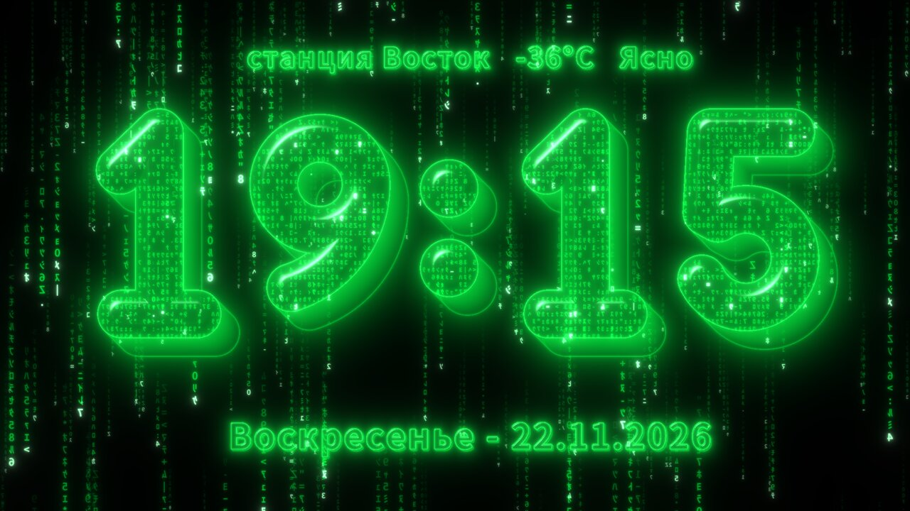

# MatrixClock

[English](README.en.md) · **Русский**

Объёмные часы-скринсейвер в стиле «Матрицы» с блокировкой сеанса для Linux — для рабочего стола X11, терминалов, SSH и голой консоли Linux.



Крупные светящиеся стеклянные цифры, заполненные падающим дождём из катаканы. Над часами — место, температура и погода, под ними — дата. Когда вы возвращаетесь, пароль проверяется через PAM, и каждая неверная попытка сдвигает всю картинку к красному.

## Содержание

- [Возможности](#возможности)
- [Требования](#требования)
- [Установка](#установка)
- [Сборка из исходников](#сборка-из-исходников)
- [Запуск](#запуск)
- [Фоновые режимы](#фоновые-режимы)
- [Блокировка](#блокировка)
- [Погода и дата](#погода-и-дата)
- [Настройка](#настройка)
- [Решение проблем](#решение-проблем)
- [Структура проекта](#структура-проекта)
- [Автор](#автор)
- [Лицензия](#лицензия)

## Возможности

- **Два способа отрисовки, одна сцена.**
  - Графический режим (X11, OpenGL 3.3): стеклянные цифры с фаской, бликами, светящейся кромкой и объёмными боковыми гранями, bloom, слои дождя по глубине, по желанию — отражение «мокрого пола».
  - Текстовый режим: та же сцена из символов — 24-битный цвет в X-терминалах и по SSH, 16 цветов в голой консоли Linux.
- **Два рисунка цифр** (`digits.style`): округлые или угловатые — прямые штрихи со скосами; к угловатым дата и погода пишутся угловатым шрифтом (Russo One, встроен).
- **Дождь взаимодействует с цифрами:** проходит сквозь них, обтекает, разбивается и капает с нижних кромок или скрывается за ними.
- **Погода и дата.** Место, температура и погода над часами (Open-Meteo, без API-ключа), дата под часами. Место определяется по IP при первом запуске и записывается в конфиг.
- **Блокировка через PAM.** Ограниченное число попыток с паузой, сдвиг цвета к красному при неверном пароле, ввод пароля в любой раскладке (XIM).
- **Фоновые режимы.**
  - В сеансе X11: запуск после N минут простоя.
  - В текстовых консолях: служба systemd через N минут простоя блокирует консоль на отдельном VT с запретом переключения.
- **Несколько мониторов.** Графический режим рисует часы на каждом мониторе (XRandR) или на выбранном.
- **Компактность.** Один бинарник около 3 МБ, шрифты встроены.

## Требования

- Linux x86_64.
- **Графический режим:** сеанс X11 с OpenGL 3.3 и расширением MIT-SCREEN-SAVER (штатное в Xorg). Фоновый режим X11 в сеансах Wayland не работает.
- **Текстовый режим:** любой терминал с UTF-8. В голой консоли для русских надписей погоды и даты нужен шрифт с кириллицей (например, `cyr-sun16`, см. [`console.font`](#console)).
- **Блокировка:** PAM и файл сервиса `/etc/pam.d/matrixclock` (ставят пакеты и `--install-system`).
- **Погода:** доступ в интернет. Без него строка погоды просто не выводится.

## Установка

Готовые пакеты приложены к [релизу на GitHub](../../releases).

| Дистрибутив | Команда |
|---|---|
| Arch Linux | `sudo pacman -U matrixclock-0.1.0-1-x86_64.pkg.tar.zst` |
| Debian 13 / Ubuntu 24.04+ | `sudo apt install ./matrixclock_0.1.0_amd64.deb` |
| Fedora 45 | `sudo dnf install ./matrixclock-0.1.0-1.fc45.x86_64.rpm` |

Каждый пакет ставит:

| Путь | Что это |
|---|---|
| `/usr/bin/matrixclock` | программа |
| `/etc/pam.d/matrixclock` | сервис PAM для блокировки (проверка пароля через `pam_unix`) |
| `/usr/share/fonts/…/MatrixClockGlyphs.otf` | шрифт символов для текстового режима в X-терминалах |
| `/usr/share/doc/matrixclock/config.example.toml` | пример конфига с комментариями |

Сами пакеты ничего не запускают. Нужные фоновые режимы включаются отдельно — см. [Фоновые режимы](#фоновые-режимы).

## Сборка из исходников

Нужны Rust ≥ 1.88 и заголовочные файлы PAM, X11, XRandR, XScreenSaver и OpenGL:

```sh
# Arch Linux
sudo pacman -S --needed rust pam libx11 libxrandr libxss libglvnd pkgconf
# Debian / Ubuntu (в Debian 13 rustc/cargo — из trixie-backports)
sudo apt install cargo rustc pkgconf libpam0g-dev libx11-dev libxrandr-dev libxss-dev libgl-dev
# Fedora
sudo dnf install cargo rust gcc pkgconf-pkg-config pam-devel libX11-devel libXrandr-devel libXScrnSaver-devel libglvnd-devel
```

Сборка, тесты и установка:

```sh
cargo build --release
cargo test --release
sudo install -m755 target/release/matrixclock /usr/local/bin/
sudo install -m644 pam/matrixclock /etc/pam.d/matrixclock
```

Без пакета то же самое делает `sudo matrixclock --install-system`: копирует программу в `/usr/local/bin`, пишет файл PAM и включает службу консоли.

### Сборка пакетов

```sh
packaging/build.sh            # все пакеты в build/
packaging/build.sh arch       # Arch (.pkg.tar.zst)
packaging/build.sh deb        # Debian (.deb)
packaging/build.sh rpm        # Fedora (.rpm)
```

- Пакет Arch собирается `makepkg` в контейнере `archlinux:base-devel` (Docker) — в чистой среде, как в devtools: в пакет не попадают пути и список пакетов машины сборщика.
- `.deb` и `.rpm` собираются в контейнерах `debian:trixie-slim` и `fedora:45` (Docker): программа собрана против glibc целевого дистрибутива. Все пакеты — только в контейнерах, нужен лишь Docker.
- Зависимости-крейты скачиваются один раз (`cargo fetch --locked`). Сама сборка идёт без сети (`--frozen`).

## Запуск

```sh
matrixclock               # графика, если задан $DISPLAY, иначе текстовый режим
matrixclock --text        # текстовый режим даже в X
matrixclock --no-lock     # только заставка: выход по любой клавише или движению мыши
```

| Ключ | Назначение |
|---|---|
| `--config <файл>` | файл настроек (по умолчанию `~/.config/matrixclock/config.toml`, затем `/etc/matrixclock/config.toml`) |
| `--text` | текстовый режим, даже если задан `$DISPLAY` |
| `--full` / `--lite` | текстовый режим: принудительно 24 бит / 16 цветов |
| `--monitor <N>` | графика только на мониторе N (0, 1, …); по умолчанию — на всех |
| `--no-lock` | не спрашивать пароль, выход по любой клавише |
| `--print-config` | вывести пример конфига с комментариями |
| `--idle-seconds` | вывести время простоя из конфига в секундах (для tmux) |
| `--daemon` | фоновый режим в сеансе X11 (см. ниже) |
| `--console-daemon` | фоновая служба для текстовых консолей (запускает systemd от root) |
| `--install` / `--uninstall` | добавить/убрать автозапуск в X для текущего пользователя |
| `--install-system` / `--uninstall-system` | установить/убрать службу консоли (root) |
| `--user <имя>` | чей пароль спрашивать (только root; использует служба) |
| `-h`, `--help` | справка |

## Фоновые режимы

### Сеанс X11

```sh
matrixclock --install      # автозапуск "matrixclock --daemon" при входе в X (~/.config/autostart)
matrixclock --daemon &     # запустить прямо сейчас
matrixclock --uninstall    # убрать автозапуск
```

- **Как работает.** Демон следит за простоем X через штатное расширение MIT-SCREEN-SAVER. Через `general.idle_minutes` без ввода он запускает скринсейвер отдельным процессом.
- **Ключи.** Ключи, переданные вместе с `--install` (`--config`, `--no-lock`, `--monitor`), записываются в автозапуск и передаются скринсейверу.
- **Оконные менеджеры без XDG autostart** (i3, dwm, голый `startx`) не читают `~/.config/autostart`. Добавьте `matrixclock --daemon &` в `~/.xprofile` или `~/.xinitrc`.
- **Один демон на дисплей.** Вторая копия не запустится.

### Текстовые консоли (служба systemd)

```sh
sudo matrixclock --install-system     # файл PAM + matrixclock-console.service, включается сразу
systemctl status matrixclock-console.service
sudo matrixclock --uninstall-system   # убрать службу (файл PAM остаётся — он нужен блокировке в X)
```

- **Как считается простой.** Служба работает от root и следит за активной консолью. Простой — время последнего ввода на терминале, как в `w`.
- **Какие консоли блокируются.** Только те, где пользователь вошёл в систему и которые в текстовом режиме. Консоли с `getty` (без входа) и сеансы X/Wayland пропускаются.
- **Как блокирует.** Переключается на свободный VT, запрещает переключение консолей и спрашивает пароль владельца консоли. После разблокировки возвращает на его консоль.
- **Конфиг.** Служба читает `/etc/matrixclock/config.toml`; при необходимости скопируйте туда свой `~/.config/matrixclock/config.toml`.

### tmux

`--idle-seconds` позволяет tmux блокировать неактивные сеансы через MatrixClock:

```sh
# ~/.tmux.conf
set -g lock-command 'matrixclock --text'
run-shell 'tmux set -g lock-after-time $(matrixclock --idle-seconds)'
```

## Блокировка

| Клавиша | Действие |
|---|---|
| любая клавиша | показать поле пароля |
| `Enter` | проверить пароль |
| `Backspace` | стереть символ |
| `Ctrl+U` | очистить поле |
| `Esc` | очистить и скрыть поле |

- **Поле пароля.** Вводимый пароль отображается случайными символами дождя. Поле скрывается само через `lock.input_timeout` секунд без нажатий. Пока поле на экране, оно стоит на месте даты.
- **Неверные попытки.** С каждым неверным паролем цвета сдвигаются к `colors.alarm_color`. После `lock.max_attempts` попыток ввод блокируется на `lock.lockout_seconds`.
- **Чей пароль.** Блокировка всегда спрашивает пароль пользователя, который её запустил. Служба консоли спрашивает пароль владельца консоли.
- **PAM.** Файл сервиса `/etc/pam.d/matrixclock` использует только `pam_unix`, как `vlock`. Это сделано намеренно: в `system-auth` есть `pam_faillock`, который после 3 неверных паролей заблокировал бы всю учётную запись. Число попыток ограничивает сам MatrixClock.
- **Защита от запирания.** Без файла PAM программа откажется блокировать экран — иначе разблокировать было бы невозможно. В этом случае запускайте с `--no-lock` или установите файл.
- **Блокировка голой консоли** (`lock.lock_all_vt = true`). Запрещает переключаться на другие консоли (`Ctrl+Alt+F1…F12`), как `vlock -a`. Нужны права root или:
  ```sh
  sudo setcap cap_sys_tty_config+ep "$(command -v matrixclock)"
  ```
  Служба консоли запрещает переключение сама, всегда.

## Погода и дата

```
станция Восток   -36°C   Ясно      ← место, температура, погода
          19:15
Воскресенье - 22.11.2026          ← день недели - дд.мм.гггг
```

- **Расположение.**
  - Строка погоды стоит по центру, посередине между верхним краем экрана и часами.
  - Дата стоит по центру, посередине между часами и нижним краем экрана.
  - В графическом режиме обе нарисованы в том же объёмном «стеклянном» стиле, что и цифры.
- **Место** — параметр `[weather] location` в конфиге.
  - **Пусто** (по умолчанию): при первом успешном запросе город определяется по IP через [ipwho.is](https://ipwho.is/) и записывается в файл настроек. Остальное содержимое файла, включая комментарии, сохраняется.
  - **Задано**: название ищется [геокодером Open-Meteo](https://open-meteo.com/en/docs/geocoding-api). Его можно уточнить регионом или страной: `"Париж, Техас"`, `"Vostok Station"`. На экран выводится название из геокодера, на языке надписей.
- **Обновление.** Погода — текущие данные [Open-Meteo](https://open-meteo.com/), обновляются раз в 15 минут, пока работает скринсейвер. API-ключ не нужен.
- **Без сети.** Если сервисы не отвечают, строка погоды скрыта, а запрос повторяется раз в минуту. Дата выводится всегда.
- **Язык.** Русский, английский, немецкий или французский — параметр `general.language`. По умолчанию (`"auto"`) берётся из локали системы (`LC_ALL`, `LC_MESSAGES`, `LANG`, первая непустая): `ru_*`, `de_*`, `fr_*` — этот язык, любая другая локаль — английский. Название места у ipwho.is и геокодера запрашивается на том же языке.

**Приватность.** Пока работает скринсейвер, программа обращается к этим сервисам:

| Сервис | Когда | Что получает |
|---|---|---|
| ipwho.is | один раз и только при пустом `location` | ваш внешний IP-адрес |
| геокодер Open-Meteo | при каждом запуске | название места |
| прогноз Open-Meteo | при каждом запуске и раз в 15 минут | координаты |

Чтобы обойтись без определения по IP, задайте `location` сами.

Погодные данные — [Open-Meteo.com](https://open-meteo.com/) (CC BY 4.0), геокодирование — на основе [GeoNames](https://www.geonames.org/).

## Настройка

**Где ищется файл.** Берётся первый найденный:

1. `--config <файл>`;
2. `~/.config/matrixclock/config.toml` (учитывается `$XDG_CONFIG_HOME`);
3. `/etc/matrixclock/config.toml`.

**Первый запуск.** Если нет ни 2, ни 3, файл 2 создаётся из примера: со всеми параметрами, значениями по умолчанию и комментариями. От root файл не создаётся.

**Проверка.** Любой параметр можно не указывать — тогда действует значение по умолчанию. Опечатка в имени параметра или значение вне диапазона — ошибка при запуске, а не молчаливое игнорирование.

Полный пример с комментариями: `matrixclock --print-config` или [`config.example.toml`](config.example.toml).

### `[general]`

| Параметр | По умолчанию | Диапазон | Описание |
|---|---|---|---|
| `idle_minutes` | `5` | 1–1440 | Через сколько минут без ввода фоновые режимы запускают скринсейвер (и значение для `--idle-seconds`). |
| `language` | `"auto"` | `auto`, `ru`, `en`, `de`, `fr` | Язык даты и погоды. `auto`: по локали системы, если она не из этих — английский. |
| `mode` | `"auto"` | `auto`, `full`, `lite` | Текстовая отрисовка. `auto`: в голой консоли (`TERM=linux`) — `lite`, иначе — `full`. `full`: 24-битный цвет и катакана. `lite`: 16 цветов и только ASCII; палитра консоли перепрограммируется в оттенки основного цвета. |

### `[clock]`

| Параметр | По умолчанию | Диапазон | Описание |
|---|---|---|---|
| `hours` | `24` | 12, 24 | Формат 24 или 12 часов (без AM/PM). |
| `seconds` | `false` | | Показывать секунды (ЧЧ:ММ:СС); цифры станут мельче. |
| `blink_colon` | `true` | | Мигать двоеточием раз в секунду. |
| `size` | `0.8` | 0.1–1.0 | Ширина часов, доля ширины экрана. |
| `max_height` | `0.62` | 0.1–1.0 | Предел высоты, доля высоты экрана (пропорции сохраняются). |
| `position_x` | `0.5` | 0.0–1.0 | Центр часов по горизонтали (0 — левый край, 1 — правый). |
| `position_y` | `0.45` | 0.0–1.0 | Центр часов по вертикали (0 — верх, 1 — низ). |
| `thickness` | `1.0` | 0.5–2.0 | Толщина линий цифр. |
| `spacing` | `1.0` | 0.0–3.0 | Расстояние между цифрами. |

### `[weather]`

| Параметр | По умолчанию | Описание |
|---|---|---|
| `location` | `""` | Название города, можно с регионом или страной. Пусто — определить по IP и записать сюда. |

### `[rain]`

| Параметр | По умолчанию | Диапазон | Описание |
|---|---|---|---|
| `density` | `0.6` | 0.0–5.0 | Сколько струй в среднем на одну колонку экрана (0.2 — редкий дождь, 1.5 — ливень). |
| `speed` | `14.0` | 1–200 | Скорость падения, символов в секунду. |
| `speed_spread` | `0.4` | 0.0–0.9 | Разброс скорости между струями. |
| `length` | `14` | 1–200 | Средняя длина хвоста, символов. |
| `length_spread` | `0.5` | 0.0–0.9 | Разброс длины хвоста. |
| `brightness` | `0.85` | 0.1–1.0 | Яркость дождя. |
| `flicker` | `20.0` | 0–100 | Сколько процентов символов на экране сменяется за секунду. |
| `charset` | `"matrix"` | | `matrix` (полуширинная катакана + цифры; в `lite` заменяется на `ascii`), `ascii`, `digits`, `binary` или любая строка — используются её символы, например `"01ABCDEF"`. |

### `[digits]`

| Параметр | По умолчанию | Диапазон | Описание |
|---|---|---|---|
| `style` | `"round"` | `round`, `angular` | Рисунок цифр. `round` — округлые (дуги, круглые концы). `angular` — угловатые (прямые штрихи, скошенные углы и концы); дата и погода тогда пишутся встроенным шрифтом Russo One. |
| `depth` | `3` | 0–10 | Глубина «выдавливания» цифр, в символах (0 — плоские). |
| `depth_direction` | `"down-right"` | | Куда уходит объём: `down-right`, `down-left`, `up-right`, `up-left`, `down`. |
| `glow` | `3` | 0–10 | Радиус свечения вокруг цифр, в символах. |
| `glow_strength` | `0.5` | 0.0–1.0 | Интенсивность свечения. |
| `fill` | `0.7` | 0.0–1.0 | Доля знакомест внутри цифр, где виден символ (0 — пустое «стекло»). |
| `brightness` | `0.6` | 0.1–1.0 | Яркость символов внутри цифр. |
| `rim` | `0.9` | 0.0–1.0 | Яркость светящейся кромки. |
| `flow` | `"through"` | | Как дождь встречается с цифрами: `through` (сквозь), `around` (обтекает по контуру), `splash` (скапливается и капает), `occlude` (цифры непрозрачны). |
| `drip_rate` | `1.0` | 0.0–10.0 | Только для `splash`: интенсивность капель с нижних кромок. |

### `[colors]`

Все цвета задаются в виде `"#rrggbb"`.

| Параметр | По умолчанию | Описание |
|---|---|---|
| `color` | `"#00ff41"` | Основной цвет дождя и цифр. |
| `alarm_color` | `"#ff1a1a"` | Цвет, к которому сдвигается картинка при неверных паролях. |
| `head_color` | `"#e0ffe8"` | Цвет «голов» струй (самый яркий символ). |
| `background` | `"#000000"` | Фон. |

### `[console]`

Только текстовый режим.

| Параметр | По умолчанию | Диапазон | Описание |
|---|---|---|---|
| `fps` | `15` | 1–60 | Частота кадров (голая консоль медленная — не завышайте). |
| `cell_aspect` | `2.0` | 1.0–4.0 | Отношение высоты знакоместа к ширине. Если «0» вытянут по вертикали — уменьшите. |
| `font` | `""` | | Шрифт голой консоли из `/usr/share/kbd/consolefonts` без расширения (`cyr-sun16`, `ter-v16n`, …). Ставится `setfont` на время работы и возвращается при выходе. Пусто — не трогать. |

### `[graphics]`

Только X11.

| Параметр | По умолчанию | Диапазон | Описание |
|---|---|---|---|
| `fps` | `60` | 1–144 | Частота кадров. |
| `font` | `""` | | Шрифт символов дождя (путь к `.ttf`/`.otf`). Пусто — встроенный (подмножество Noto Sans JP). |
| `glyph_size` | `26` | 8–96 | Высота символа дождя, пикселей. |
| `mirror_glyphs` | `true` | | Зеркальные символы, как в фильме. |
| `layers` | `3` | 1–4 | Слои дождя по глубине (дальние мельче, тусклее и медленнее). |
| `bevel` | `0.6` | 0.1–1.0 | Скругление граней цифр (0.1 — острые, 1.0 — «трубка»). |
| `specular` | `0.8` | 0.0–1.0 | Блики на «стекле». |
| `bloom` | `1.0` | 0.0–3.0 | Сила свечения (bloom). |
| `exposure` | `1.0` | 0.2–4.0 | Общая яркость кадра. |
| `vignette` | `0.4` | 0.0–1.0 | Затемнение углов экрана. |
| `reflection` | `0.0` | 0.0–1.0 | Отражение «мокрого пола» внизу экрана (0 — без пола). |
| `floor_height` | `0.2` | 0.05–0.5 | Высота пола, доля высоты экрана (при `reflection` > 0). |

### `[lock]`

| Параметр | По умолчанию | Диапазон | Описание |
|---|---|---|---|
| `enabled` | `true` | | Требовать пароль для выхода. `false` — выход по любой клавише или движению мыши. |
| `pam_service` | `"matrixclock"` | | Имя сервиса PAM (`/etc/pam.d/<имя>`). |
| `prompt` | `"PASSWORD:"` | | Надпись в поле пароля (ASCII — для голой консоли). |
| `input_timeout` | `10` | 1–600 | Через сколько секунд без нажатий скрыть поле пароля. |
| `max_attempts` | `5` | 1–100 | Сколько неверных паролей допускается до паузы. |
| `lockout_seconds` | `60` | 0–3600 | Длительность паузы. |
| `lock_all_vt` | `false` | | Голая консоль: запретить переключение VT на время блокировки (нужен root или `cap_sys_tty_config`). |

## Решение проблем

| Сообщение / симптом | Причина и решение |
|---|---|
| `нет сервиса PAM "matrixclock"` | Нет файла PAM. Установите пакет, или `sudo install -m644 pam/matrixclock /etc/pam.d/matrixclock`, или запускайте с `--no-lock`. |
| `не удалось захватить клавиатуру/мышь` | Клавиатуру держит другая программа: открытое меню, другой блокировщик экрана, вторая копия MatrixClock. Демон X повторяет попытку каждые 10 с. |
| `--daemon работает только в сеансе X11` | Сеанс Wayland. Фоновый режим поддерживает только X11; текстовый режим работает в любом терминале. |
| `X-сервер без расширения MIT-SCREEN-SAVER` | У X-сервера нет расширения учёта простоя; включите его в настройках сервера. |
| `lock_all_vt: не удалось запретить переключение VT` | Нужен root или `sudo setcap cap_sys_tty_config+ep "$(command -v matrixclock)"`. |
| `TOML parse error … unknown field` | Опечатка в имени параметра, или конфиг записан более новой версией, чем запущенная программа. |
| Квадратики вместо катаканы в терминале | В шрифте терминала нет катаканы: поставьте `noto-fonts-cjk` или задайте `rain.charset = "ascii"`. |
| Квадратики вместо кириллицы в голой консоли | Задайте консольный шрифт с кириллицей: `console.font = "cyr-sun16"`. |
| Нет строки погоды | Нет интернета или место не найдено (сообщение выводится один раз). Дата выводится в любом случае. |

## Структура проекта

```
src/
  main.rs     командная строка, главные циклы графики и текста
  config.rs   конфиг: загрузка, проверка, создание при первом запуске, запись места
  info.rs     погода (ipwho.is, Open-Meteo) и дата
  scene.rs    дождь и цифры в знакоместах (общая часть обоих режимов)
  shape.rs    цифры как аналитические штрихи (масштабируемое поле расстояний)
  gfx.rs      OpenGL: цифры и надписи через SDF, атлас символов, bloom
  xwin.rs     окно X11, GLX, захват клавиатуры, ввод через XIM, XRandR, простой
  term.rs     вывод в терминал: цвета, палитра консоли, отрисовка изменений
  tty.rs      raw-режим терминала, размер, разбор клавиш
  lock.rs     логика поля пароля, попытки, пауза
  pam.rs      минимальная обвязка libpam (pam_authenticate)
  daemon.rs   фоновые режимы и их установка
assets/fonts/ встроенные шрифты: символы (Noto Sans JP) и надписи к угловатым цифрам (Russo One), OFL
pam/          файл сервиса PAM
packaging/    build.sh, PKGBUILD, deb.sh, rpm.sh, matrixclock.spec
debian/       сборка пакета Debian
```

## Автор

Суслов П. В. — [@MadBikerBest](https://github.com/MadBikerBest)

## Лицензия

Программа распространяется по [лицензии MIT](LICENSE). Встроенный шрифт `assets/fonts/MatrixClockGlyphs.otf` — подмножество Noto Sans JP (© Google / Adobe) по лицензии SIL Open Font License 1.1, см. [`assets/fonts/OFL.txt`](assets/fonts/OFL.txt). Встроенный шрифт `assets/fonts/MatrixClockText.ttf` — подмножество Russo One (© Jovanny Lemonad, зарезервированное имя «Russo»; семейство переименовано в «MatrixClock Text») по той же лицензии, см. [`assets/fonts/OFL-Russo.txt`](assets/fonts/OFL-Russo.txt).
